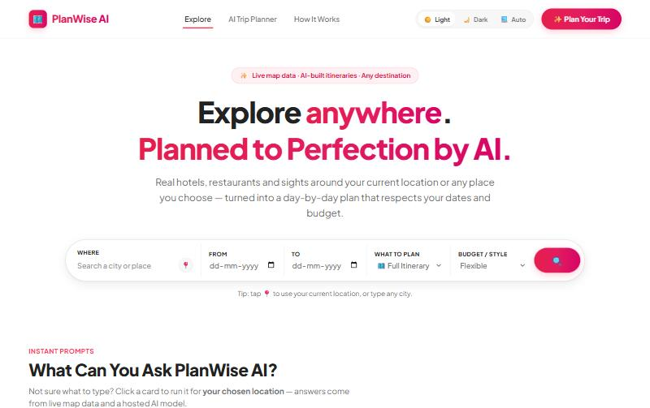

# PlanWise AI

> Agentic travel and personal planning assistant

[Live demo](https://planwise-ai-bqcm.onrender.com) · [API docs](https://planwise-ai-bqcm.onrender.com/docs)

PlanWise AI converts natural-language requests into practical, constraint-aware plans. Choose any destination or use your current location, add dates and travellers, and ask for an itinerary, hotels, restaurants, attractions, transport, or a study schedule.



## Features

- Worldwide place search and browser geolocation.
- Live hotels, restaurants, attractions, and transport hubs from OpenStreetMap.
- Day-by-day itineraries with dates, time slots, costs, and traveller-aware totals.
- Natural-language replanning for changed budgets, dates, and preferences.
- Groq, Gemini, OpenRouter, Pollinations, custom OpenAI-compatible endpoints, and optional Ollama.
- Deterministic fallbacks when an LLM is unavailable.
- Automatic destination currency selection.
- FastAPI backend with Swagger/OpenAPI documentation.
- Responsive vanilla JavaScript frontend with theme support.

> The Render free-tier demo may take about a minute to wake after inactivity.

## Architecture

```text
Browser → FastAPI → Planning agent
                    ├─ LLM provider chain
                    ├─ OpenStreetMap/Nominatim live data
                    ├─ MultiWOZ Cambridge dataset
                    └─ Constraint validation and replanning
```

The repository includes a Cambridge MultiWOZ 2.2 dataset. Local development can optionally use FAISS semantic indexes; the lightweight Render deployment uses metadata filtering to stay within free-tier resource limits.

## Project structure

```text
backend/
  app/
    agent/        Planning state machine
    api/          FastAPI routes
    geo/          Geocoding and live places
    llm/          LLM provider chain
    models/       Pydantic schemas
    retrieval/    Dataset and optional FAISS search
    tools/        Hotel, restaurant, attraction, transport tools
    validation/   Constraint checks
  scripts/        Dataset preprocessing and index creation
  tests/          Pytest suite
frontend-web/     Vite + vanilla JavaScript frontend
frontend/         Optional legacy Streamlit client
evaluation/       Evaluation cases
render.yaml       Render deployment blueprint
.env.example      Configuration template
start.ps1         Windows launcher
```

## Quick start

### Requirements

- Python 3.9+
- Node.js and npm
- Optional free LLM API key

### Windows

```powershell
.\start.ps1
```

This installs dependencies and starts both the FastAPI backend and Vite frontend.

### macOS/Linux

```bash
python3 -m venv .venv
source .venv/bin/activate
pip install -r backend/requirements.txt
cp .env.example .env

cd frontend-web
npm install
cd ..
```

Start the backend:

```bash
cd backend
python -m scripts.preprocess_multiwoz
python -m uvicorn app.main:app --host 0.0.0.0 --port 8000 --reload
```

In another terminal, start the frontend:

```bash
cd frontend-web
BACKEND_PORT=8000 npm run dev
```

Open the Vite URL, usually `http://localhost:5173`. Backend API docs are available at `http://localhost:8000/docs`.

## LLM setup

Without a key, PlanWise uses the keyless Pollinations fallback, which is slow and rate-limited. For normal use, add one or more keys to `.env`:

```dotenv
LLM_PROVIDER=auto
GROQ_API_KEY=your_key
# GEMINI_API_KEY=your_key
# OPENROUTER_API_KEY=your_key
```

`auto` tries configured providers in order, then falls back to Pollinations. See `.env.example` for all provider, timeout, geocoding, retrieval, and agent settings. Never commit `.env` or API keys.

## API

All endpoints use the `/api/v1` prefix.

| Method | Endpoint | Purpose |
|---|---|---|
| GET | `/health` | Backend and LLM status |
| GET | `/geo/search?q=...` | Destination autocomplete |
| GET | `/geo/reverse?lat=...&lon=...` | Reverse geocoding |
| POST | `/geo/prefetch?lat=...&lon=...` | Warm live place data |
| POST | `/sessions` | Create a planning session |
| GET | `/sessions/{id}` | Read session state |
| POST | `/sessions/{id}/messages` | Send a planning request |
| POST | `/sessions/{id}/messages/{request_id}/cancel` | Cancel a request |
| GET | `/sessions/{id}/plan` | Read the current plan |
| POST | `/sessions/{id}/replan` | Apply changes and replan |

Use `/docs` for complete schemas and interactive requests.

## Data

OpenStreetMap/Nominatim supplies worldwide geocoding and nearby place data. Results depend on OpenStreetMap coverage and the public service's rate limits.

The bundled Cambridge data comes from MultiWOZ 2.2 and includes hotels, restaurants, attractions, and trains. To prepare it:

```bash
cd backend
python -m scripts.preprocess_multiwoz
```

With the full local requirements installed, optional FAISS indexes can be built with:

```bash
python -m scripts.build_index
```

## Tests

```bash
cd backend
pytest -q

cd ../frontend-web
npm run build
```

## Deployment

`render.yaml` configures one Render web service. It installs `backend/requirements-deploy.txt`, preprocesses the dataset, starts Uvicorn, and serves the frontend and API from one service.

Add `GROQ_API_KEY` and/or `GEMINI_API_KEY` as secret environment variables in Render. The health check is `/api/v1/health`.

## Limitations

- Recommendations are not bookings or reservations.
- OpenStreetMap data may omit prices, hours, or contact details.
- Costs are estimates, not live quotes.
- Sessions are stored in memory and disappear on restart.
- The public Nominatim service is not intended for high-volume production traffic.
- Browser geolocation requires permission and HTTPS or localhost.

## Documentation

- [Product requirements](PlanWise_AI_PRD.txt)
- [System architecture](PlanWise_AI_Complete_System_Architecture.txt)
- [API specification](PlanWise_AI_API_Specific_Document.txt)
- [Technology stack](PlanWise_AI_Technology_Stack.txt)
- [Project decision history](PlanWise_AI_Project_Context_and_Decision_History.md)
- [MultiWOZ 2.2](https://github.com/budzianowski/multiwoz)
- [Nominatim API](https://nominatim.org/release-docs/latest/api/Overview/)

## License

No license file is currently included in this repository. Add an explicit license before distributing the project.
